# LimitBuddy — ESP32 desk display for AI coding usage limits

**LimitBuddy** keeps your AI coding agents' usage limits on a 4.3-inch ESP32 touchscreen beside your keyboard: session and weekly quota, reset countdowns and low-limit alerts for **Claude Code, OpenAI Codex, Gemini CLI, Z.AI / ZCode, OpenCode, GitHub Copilot, Cursor and Antigravity**. An animated companion — **NOVA**, **ORBIT**, the Claude Code pixel critter **CLAUDE**, and on the P4 also **WRAITH** and **GLITCH** — reacts to recorded token activity on your PC. They are sharp and a little menacing on purpose, not mascots. USB only: no Wi-Fi, no cloud relay, keys stay on the PC.

*Formerly **AI Monitor P4** (`ai-monitor-p4-s3`); old links redirect here.*

New candidate package: **[v1.19.1-rc24](https://github.com/catorendal-a11y/limitbuddy/releases/tag/v1.19.1-rc24)**,
with a full-color terminal dashboard, direct device navigation, observed agent sessions,
local-day history, companion packs, private diagnostics and
[real USB device-screen capture](docs/DEVICE_MIRROR.md). This is a prerelease;
physical permission control remains disabled pending hardware/provider validation.

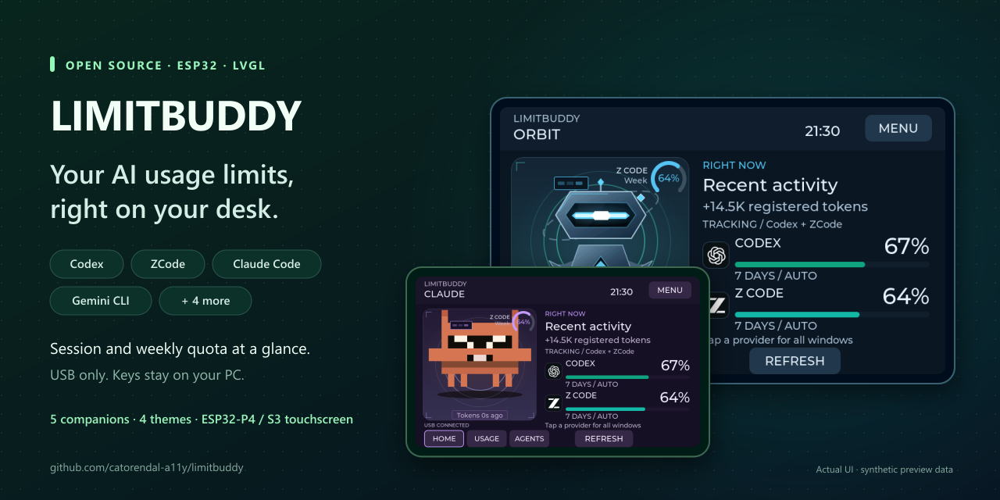

The [LimitBuddy terminal application](docs/TERMINAL.md) is now the PC app. Download one
Windows x64 terminal ZIP, extract it into a permanent writable folder, and double-click
**Install-LimitBuddy.cmd** once. Open a new terminal and type:

```powershell
limitbuddy
```

Python and the required libraries are included, so installation needs no additional
downloads or separate Python, pip, Node.js or npm setup. NOVA remains source code;
there is no separate NOVA EXE or Qt application.
NOVA provides setup, host controls, integrations, history, firmware and companion
operations through the shared backend. **1–5** changes page, **Tab/Enter** uses
controls, **?** opens help and **Q** quits. Use a 120 × 30 character window or larger.
Use `limitbuddy --version` or `limitbuddy --help` for command information.

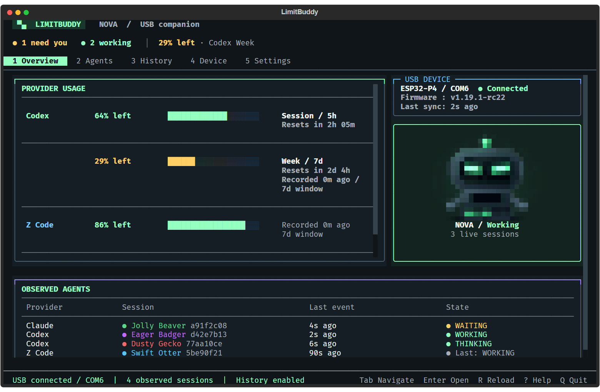

<p align="center">
  <a href="https://github.com/catorendal-a11y/limitbuddy/releases/tag/v1.19.1-rc24"></a>
  <a href="https://github.com/catorendal-a11y/limitbuddy/commits/main"></a>
  <a href="https://github.com/catorendal-a11y/limitbuddy/actions/workflows/ci.yml"></a>
  <a href="LICENSE"></a>
  <a href="https://github.com/catorendal-a11y/limitbuddy/stargazers"></a>
</p>
<p align="center">
  <a href="docs/BOARDS.md"></a>
  <a href="docs/BOARDS.md"></a>
  <a href="docs/BOARDS.md"></a>
  <a href="platformio.ini"></a>
  <a href="docs/DEVELOPMENT.md"></a>
</p>
<p align="center">
  <a href="docs/CODEX_SETUP.md"></a>
  <a href="docs/PROVIDERS.md#zcode"></a>
  <a href="docs/PROVIDERS.md#claude-code"></a>
  <a href="docs/PROVIDERS.md#gemini-cli"></a>
  <br>
  <a href="docs/PROVIDERS.md#external-numeric-bridge"></a>
  <a href="docs/PROVIDERS.md#external-numeric-bridge"></a>
  <a href="docs/PROVIDERS.md#external-numeric-bridge"></a>
  <a href="docs/PROVIDERS.md#external-numeric-bridge"></a>
</p>
<p align="center">
  <a href="#make-it-yours"></a>
  <a href="#make-it-yours"></a>
  <a href="docs/QUICK_START.md#everyday-use"></a>
  <a href="docs/QUICK_START.md"></a>
</p>
<p align="center">
  <a href="https://github.com/catorendal-a11y/limitbuddy/releases/tag/v1.19.1-rc24"></a>
  <a href="docs/QUICK_START.md"></a>
  <a href="docs/QUICK_START.md"></a>
  <a href="docs/DEVELOPMENT.md"></a>
</p>
<p align="center">
  <a href="docs/GITHUB_SECURITY.md"></a>
  <a href="docs/PROVIDERS.md#privacy-and-limits"></a>
  <a href="docs/GITHUB_SECURITY.md"></a>
</p>

*Quota needs the provider's supported account/key/bridge. Gemini, OpenCode and external numeric bridges report activity only. S3 remains experimental. The graphical Windows app and EXE distribution are retired.*

[](https://github.com/catorendal-a11y/limitbuddy)

**[Download LimitBuddy terminal](https://github.com/catorendal-a11y/limitbuddy/releases/tag/v1.19.1-rc24)** · [Quick Start](docs/QUICK_START.md) · [Provider setup](docs/PROVIDERS.md) · [Ask a question](https://github.com/catorendal-a11y/limitbuddy/discussions/categories/q-a)

**Why put AI activity on your desk?** Keep supported quota windows visible on a dedicated display, and see registered work without opening another app. The PC companion connects to your selected P4 or S3 display over USB. Choose the providers you use, pick your robot and colors, and keep your main screen for your work.

**Two board choices · Three animated companions · Four color themes · No AI preselected · LimitBuddy terminal setup**

## Watch the two-minute overview

[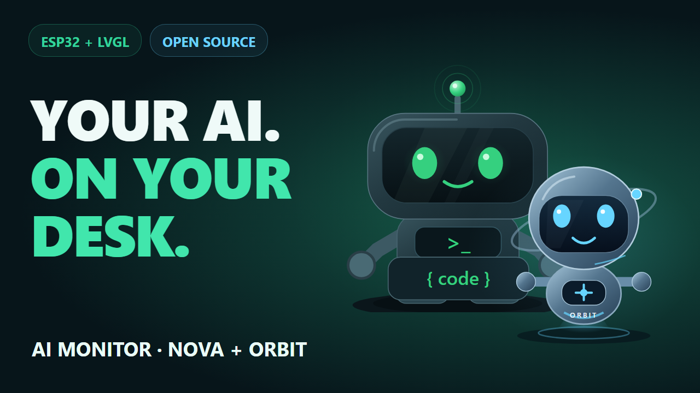](https://www.youtube.com/watch?v=1JR9_E1lWDg)

**[Watch on YouTube](https://www.youtube.com/watch?v=1JR9_E1lWDg)** — Meet NOVA and ORBIT, see the actual display UI, and learn how USB, provider setup, quota windows and themes fit together. The video includes the retired graphical PC app as historical footage; current Windows releases use the LimitBuddy terminal. English narration, timed subtitles and chapters are included. UI previews use synthetic data; S3 remains experimental.

## Meet your desk companion

| NOVA | ORBIT with the Ocean theme | CLAUDE with the Amethyst theme |
| --- | --- | --- |
| 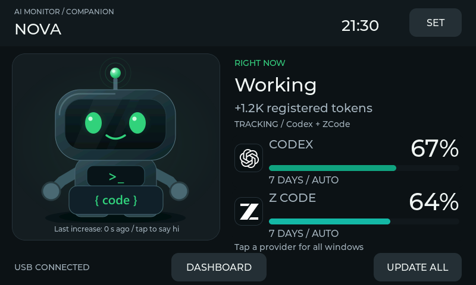 | 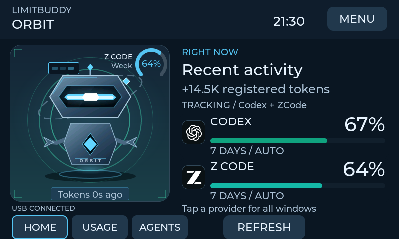 | 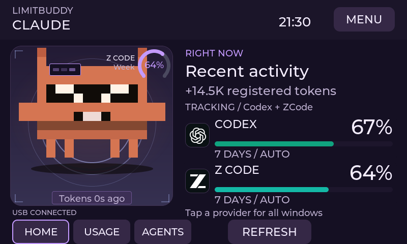 |

These previews are rendered from the actual LVGL interface using synthetic data. They are UI renders, not photographs of the display.

The companion panel uses less horizontal space while preserving the robot's size. Usage percentages, provider names and status text have larger fonts so they are easier to read on the 4.3-inch display.

## What you need

Choose one of the two firmware targets:

| Display board | Status | USB connector |
| --- | --- | --- |
| **GUITION JC4880P433 ESP32-P4** | Supported | Espressif USB data port |
| **Original Waveshare ESP32-S3-Touch-LCD-4.3** | **Experimental; not yet tested on physical S3 hardware** | **USB TO UART**, for flashing and daily use |

The S3 target is the original CH422G model, **not B or C**. [Board compatibility, brightness differences and setup](docs/BOARDS.md).

- Your selected board from the table above.
- A **USB data cable** connected to the board's USB data port.
- A **Windows 10/11 x64 PC**, plus your own AI account or local CLI installation.

The terminal ZIP includes PC source, a verified private Python runtime with hash-locked libraries, and both boards' prebuilt firmware. Install-LimitBuddy.cmd registers `limitbuddy` without extra downloads. No PlatformIO or Arduino IDE is needed for ordinary use. Linux/macOS users can run the terminal from source.

## PC companion: LimitBuddy terminal

Use the five terminal pages for Overview, Agents, History, Device and Settings. Quota
age, observed sessions and USB status remain separate. Device provides confirmed
firmware updates, companion packs and screen capture through the existing USB host.

<details>
<summary>Earlier graphical app previews (retired; historical reference)</summary>

### Earlier graphical PC companion

The retired **AI-Monitor.exe** provided a native window with NOVA artwork, a NOVA program icon, board/provider controls and a terminal-style activity log. Each AI had visible setup instructions, including ZCode's optional Coding Plan key and the requirements for activity-only bridges. Users could save settings, start or stop the hidden host, or open the Firmware tab to install the verified board-specific image. The window read local status; it did not generate AI prompts.

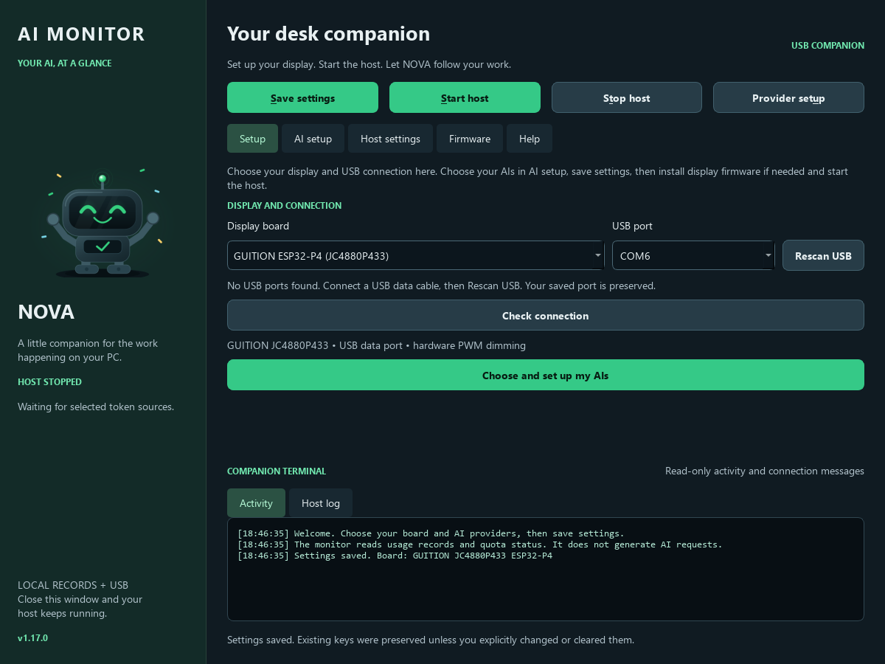

*Actual desktop app rendered with synthetic saved settings. Fresh installations have no board or provider preselected.*

[Preview AI setup and provider choices](docs/media/desktop-ai-setup.png). ZCode's masked key field appears only when it is selected; leave it blank to preserve an existing key.

**Check AI setup** separates local activity, account quota, USB delivery and session events, with a 60-second observation test and the next action for each AI. Optional **History** shows local token increases, quota charts and cautious consumption estimates. Claude users can explicitly link session events so your companion shows **Working**, **Needs you** and **Turn complete**, alongside the separate subscription-quota link. [Checklist, history and session setup](docs/USAGE_INSIGHTS.md).

OpenCode reads local numeric usage automatically. Copilot, Cursor and Antigravity still require an advanced numeric bridge; selecting them alone cannot import editor usage. Session events currently support Claude Code only; the other AIs use recorded token activity.

**Host settings:** choose USB retry speed, local token read speed, terminal text size, automatic start, minimize/close-to-tray behavior, and whether quitting stops the host. **Check connection** verifies the display without flashing. The sidebar shows USB health separately from account quota; corrupt configuration has an explicit backup-and-recover flow. [Preview Host settings](docs/media/desktop-host-settings.png) or read the [connection guide](docs/QUICK_START.md#connection-checks-and-host-preferences).

**NOVA system tray:** minimizing hides the desktop window under its NOVA icon near the clock. Click the icon or open the shortcut again to restore the same window. Right-click for Open, Start host, Stop host and Quit. Close-to-tray is optional; hiding retains unsaved settings and never stops the independent host. Existing v1.17.2 display firmware works with this desktop feature.

[Preview the tray settings](docs/media/desktop-tray-settings.png) (actual desktop app with synthetic setup, no account data).

**Guided setup:** the progress checklist and Next button lead through display, USB port, AI choices, saving and connection checks. Start stays disabled while those selections are incomplete or unsaved. A new/factory board gets firmware help; nothing is flashed automatically. Reopening with automatic host start enabled reuses an existing host.

[Preview guided setup](docs/media/desktop-guided-setup.png) · [Desktop performance measurements](docs/DESKTOP_PERFORMANCE.md).

</details>

## Get running on Windows

**Before you start**

- **Hardware:** a supported 4.3-inch display (Guition ESP32-P4, or the experimental Waveshare S3), a data-capable USB cable, and a Windows 10/11 PC (x64). Without the display there is little to see.
- **Not code-signed:** the ZIP is built by GitHub from this repository (check it against `SHA256SUMS.txt`), but it is not signed by a publisher. Windows SmartScreen may warn the first time: choose **More info > Run anyway** only if you downloaded it from this repository's Releases page.
- **Extract first:** unpack the whole ZIP into a permanent folder you can write to (not `Program Files`, not inside the ZIP viewer) and keep it there; the `limitbuddy` command points at that folder.

**Steps**

1. **Download and prepare.** Download the Windows x64 terminal ZIP from [Releases](https://github.com/catorendal-a11y/limitbuddy/releases/tag/v1.19.1-rc24) and extract it into a permanent writable folder.
2. **Install the command once.** Double-click **Install-LimitBuddy.cmd**. It checks the bundled runtime and registers `limitbuddy` for your user (the older `nova` command keeps working as an alias). Open a new terminal and type `limitbuddy`. No separate Python, package downloads or administrator rights are needed.
3. **Choose your board and AI tools.** In **Settings > Edit settings**, choose P4 or S3, providers and USB port, then save. With multiple USB boards connected, choose the explicit COM port instead of `auto`. No AI is preselected. To see sessions on the **Agents** screen and get the "agent needs you" alert, open **Agents > Provider events** in the terminal and link Claude Code and/or Codex; nothing is linked automatically.
4. **Prepare the display.** On a new board, open **Device > Firmware**, select **First installation**, review the board/port and type `FLASH`. This resets display settings. Existing LimitBuddy boards can use the application update to preserve settings. Nothing is flashed automatically.
5. **Start the companion.** Use **Settings > Start host**. The host can keep running after closing the terminal; the saved close preference controls this. Sign-out or shutting down the PC stops it, unless you switch on **Start at Windows sign-in** in **Settings > Edit settings**: the display then comes back by itself after every restart (a per-user Startup entry; it needs no administrator rights and can also be turned off in Windows Settings > Apps > Startup).

**Something not working?**

- `limitbuddy` is not recognized: open a **new** terminal after running **Install-LimitBuddy.cmd**.
- The display says **NO HOST**: use **Settings > Start host**, and check the port in **Settings > Edit settings** (pick the explicit COM port if several boards are connected). Optionally switch on **Start at Windows sign-in** so it comes back after a restart.
- The Agents screen is empty: that is expected until the providers are linked (see step 3); the screen names the ones that are not linked.
- Anything else: **History > Diagnostic export** writes a report with no keys or conversations that you can attach to an [issue](https://github.com/catorendal-a11y/limitbuddy/issues).

**Upgrading from an earlier release?** Each release lives in its own folder, and your settings stay in the old one until you move them:

1. Extract the new ZIP into a new permanent folder (for example `LimitBuddy\app-rc19`) and double-click its **Install-LimitBuddy.cmd**. `limitbuddy` now opens the new version.
2. In the **old** version, use **Settings > Stop host**.
3. Copy `tools\aim_host.json` (board, port, providers and keys) and, if you use history, the `tools\activity` folder from the old folder into the new one.
4. Run `limitbuddy`, check **Settings**, then **Settings > Start host**. If you use **Start at Windows sign-in**, open **Edit settings** and press **Save** once so the Startup entry points at the new folder.
5. Update the display from the new version: **Device > Firmware > Application update** keeps display settings.
6. If you linked provider events or the Claude quota bridge, re-link them from **Agents**. Keep the old folder until everything works.

**Already using P4 firmware v1.12.0 or later?** The new host recognizes its existing identity. Update the application firmware for the new on-device quota selector and larger alerts; this retains display settings. A new S3 board requires its own first installation.

**[Windows x64 terminal ZIP](https://github.com/catorendal-a11y/limitbuddy/releases/download/v1.19.1-rc24/nova-v1.19.1-rc24-windows-x64-terminal.zip)** · [SHA-256 checksum](https://github.com/catorendal-a11y/limitbuddy/releases/download/v1.19.1-rc24/SHA256SUMS.txt) · [Installation and migration guide](docs/TERMINAL.md)

The graphical Windows app and EXE distribution are retired. Existing rc14 display firmware works with the terminal-only PC change; updating the display is optional. Preserve settings/history and retarget existing hooks before removing an old EXE installation; see the migration guide above.

GitHub's automatic **Source code (zip)** contains source only, without prebuilt firmware. The terminal release ZIP adds verified board images.

## PC requirements

Use Windows 10/11 x64, a USB data cable and your supported display. Windows Terminal is recommended. The ZIP includes Python and its dependencies; installation works offline after downloading it. Provider quotas and optional AI-client setup still need internet. No Qt, Node.js, npm, Git, PlatformIO or Arduino IDE is required for ordinary use. [PC requirements](docs/PC_REQUIREMENTS.md) · [Codex setup](docs/CODEX_SETUP.md).

## Provider setup

Token activity and account quota are separate signals. A provider can animate the robot from local token records without providing a remaining-quota percentage.

| Provider | Token activity | Quota display |
| --- | --- | --- |
| **Codex** | Local Codex database | Signed-in official Codex CLI; setup offers installation/sign-in. |
| **ZCode** | Local ZCode database | Your optional Z.AI coding-plan API key. |
| **Claude Code** | Local CLI usage records | Optional documented statusline bridge, offered in Provider setup. |
| **Gemini CLI** | Recorded local CLI sessions | Activity only; automatic account quota is unavailable. |
| **GitHub Copilot** | External numeric bridge | Activity only; editor usage is not imported automatically. |
| **Cursor** | External numeric bridge | Activity only. |
| **Antigravity** | External numeric bridge | Activity only. |
| **OpenCode** | Local SQLite usage | Automatic local activity; no remaining account quota. |

**External bridge** means you must connect an integration that supplies cumulative token counts. Selecting that provider alone does not enable automatic tracking. See [provider requirements and bridge examples](docs/PROVIDERS.md).

Codex setup uses the official client and your own sign-in flow; the monitor does not ask for an OpenAI password or key. Existing CLI installations and account storage are reused. You can decline installation/sign-in and finish later with **Provider setup**. [Codex setup guide](docs/CODEX_SETUP.md).

## Make it yours

On the companion screen, open **SET > AI USAGE**. PREV/NEXT chooses an AI. The screen explains its quota windows, how to enable quota in the PC app, the selected window, and the percentage remaining for each reported window.

- **Codex:** **5 HOURS** is the short-term limit; **7 DAYS** is the weekly limit. Sign in to the official Codex CLI with ChatGPT from the PC app.
- **ZCode:** **5 HOURS / 7 DAYS** are model quotas when supplied by the plan; **MONTHLY MCP** is the separate monthly tool-call quota, not a monthly model-token budget. Add your own ZAI Coding Plan key in the PC app. [Official ZCode usage guide](https://zcode.z.ai/en/docs/usage-stats).
- **Claude Code:** optional statusline bridge for reported **5 HOURS / 7 DAYS**. **Gemini CLI:** local recorded activity only. External editor integrations explain their numeric bridge requirements.

Known windows remain visible and can be selected before their data arrives. **NOT REPORTED** never means unused quota: the companion shows unavailable until real data is received. Percentages update while Settings is open; **REFRESH** reloads the reported options and requests a host update. **AUTO / MOST URGENT** follows the most urgent quota. Choices are saved independently on the display, and alerts still check every window.

| Codex window selection | ZCode window selection |
| --- | --- |
| 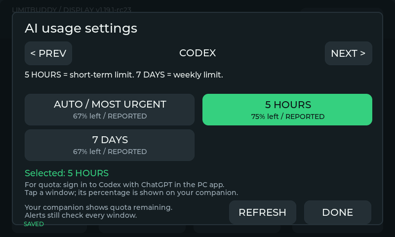 | 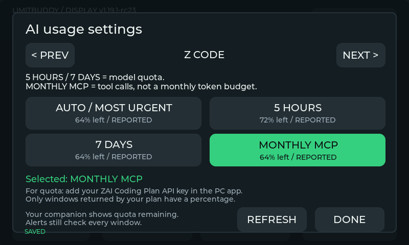 |

On the display, open **SET > APPEARANCE**. Choose **NOVA** or **ORBIT**, then **Forest**, **Ocean**, **Amethyst** or **Ember**. Changes apply immediately and are saved on the display. Provider branding and warning colors keep their meanings across themes.

| Robot and color settings | Provider dashboard |
| --- | --- |
| 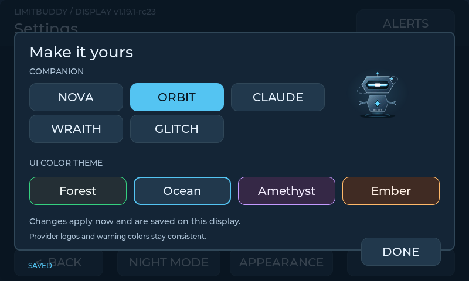 | 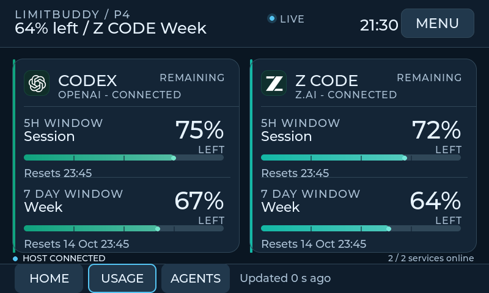 |

| ORBIT in Amethyst | NOVA in Ember |
| --- | --- |
| 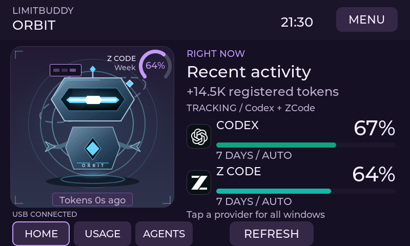 | 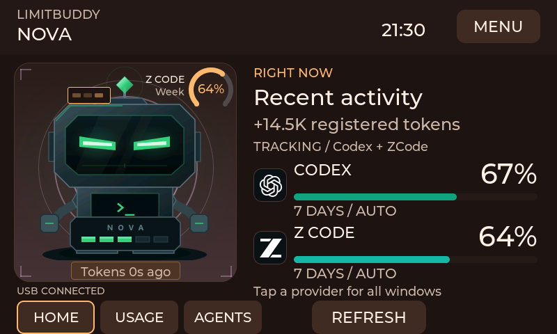 |

[View the provider details screen](docs/ui/details-ocean.png).

The display also includes reset countdowns, manual refresh, low/critical quota warnings, session history, brightness presets, gradual idle dimming and scheduled night brightness. P4 dims its LED backlight with PWM; S3 dims the rendered image and switches LEDs off only at zero. See [board differences](docs/BOARDS.md#brightness-and-performance).

[Preview the larger quota alert](docs/ui/quota-critical-notification.png).

## Everyday use

| Control | What it does |
| --- | --- |
| **Settings / Edit settings** | Choose board, providers and port; preserve saved keys unless explicitly changed. |
| **Start host / Stop host** | Manage only this folder's independent background companion. |
| **Agents / Check AI setup** | Check provider readiness and instructions. **Codex sign-in** opens the official setup console; Claude has a separate quota-link action. |
| **Firmware** | Review the selected board, chip and verified image before typing FLASH. |
| **Settings / Recent host log** | Read bounded local messages; API keys and control sequences are filtered. |
| **? Help** | Show terminal navigation and keyboard help. |

Use `limitbuddy --version` and `limitbuddy --help` for command information. `limitbuddy --check` uses synthetic data; check the live USB connection on the Device page.

When upgrading, stop the old host before opening a newly extracted package. Preserve private configuration/history and retarget existing integrations before removing the old runtime. [Upgrade instructions](docs/TERMINAL.md#upgrade-and-migrate).

## If the robot is quiet

The robot follows **increases in recorded token counters**. The first sample establishes a baseline; existing totals do not count as fresh activity. Some clients save token usage only when a request finishes, so activity can lag generation.

| Symptom | First check |
| --- | --- |
| No USB connection | Use a data cable and the correct USB port; close other serial tools. |
| Robot does not react | Check the observed status and Recent host log; use Device / Check USB for the connection. |
| Codex quota is unavailable | Use Provider setup to finish official CLI sign-in; account quota requires a supported ChatGPT-backed login. |
| External provider stays inactive | Connect its numeric telemetry bridge; selection alone does not supply data. |

This is an activity and quota display, not a billing ledger or per-token stream. Unsupported local formats remain unavailable. Display history clears after a firmware restart. [More troubleshooting](docs/QUICK_START.md#if-something-does-not-work).

## Privacy and security

The PC companion reads selected local usage sources, queries provider quota over HTTPS and sends display data over USB. It has no incoming network listener or automatic GitHub code updater. GitHub Actions run on GitHub-hosted machines; this repository has no runner or webhook connected to the maintainer's PC.

No maintainer credentials are included in the source or release. Your optional Z.AI key is stored in plaintext in local `tools/aim_host.json`, which is ignored by Git; keep that file private. `ZAI_API_KEY` in the process environment takes precedence. The host does not automatically load `.env` files. Obtain the terminal ZIP and checksum from this repository's release page; the current package contains no application EXEs.

[Security and private reporting](SECURITY.md) · [Host security review](docs/SECURITY_REVIEW.md) · [GitHub safeguards](docs/GITHUB_SECURITY.md)

## Run from source or contribute

Built one? [Share your display in Show and tell](https://github.com/catorendal-a11y/limitbuddy/discussions/categories/show-and-tell). Have a setup question? Use [Q&A](https://github.com/catorendal-a11y/limitbuddy/discussions/categories/q-a). Suggest improvements in [Ideas](https://github.com/catorendal-a11y/limitbuddy/discussions/categories/ideas), or [report a reproducible bug](https://github.com/catorendal-a11y/limitbuddy/issues/new/choose). Keep keys, account data and private logs out of posts.

If the project helps your setup, a GitHub star makes it easier to find again. Follow the repository's releases to hear about updates.

Source installations require **Python 3.10+**. On Windows, double-click **AI-Monitor.bat** to create the local environment and open the terminal. On Linux/macOS:

```sh
sh setup.sh
.venv/bin/python tools/aim_terminal.py
```

Firmware builds, serial permissions and test dependencies are covered in the [developer guide](docs/DEVELOPMENT.md). The [release guide](docs/RELEASING.md) explains the separate build/publish jobs and reviewed draft releases. Ordinary source pushes do not publish a release.

[Contributing](CONTRIBUTING.md) · [Provider roadmap](docs/PROVIDER_ROADMAP.md) · [All releases](https://github.com/catorendal-a11y/limitbuddy/releases)

Project-owned code and original NOVA/ORBIT artwork use [MIT](LICENSE). Drivers, dependencies, fonts and provider marks retain their own terms: [third-party notices](THIRD_PARTY_NOTICES.md), [NOVA/logo sources](assets/nova/SOURCES.md) and [ORBIT artwork](assets/orbit/SOURCES.md). This is an independent project and is not endorsed by its AI providers.
