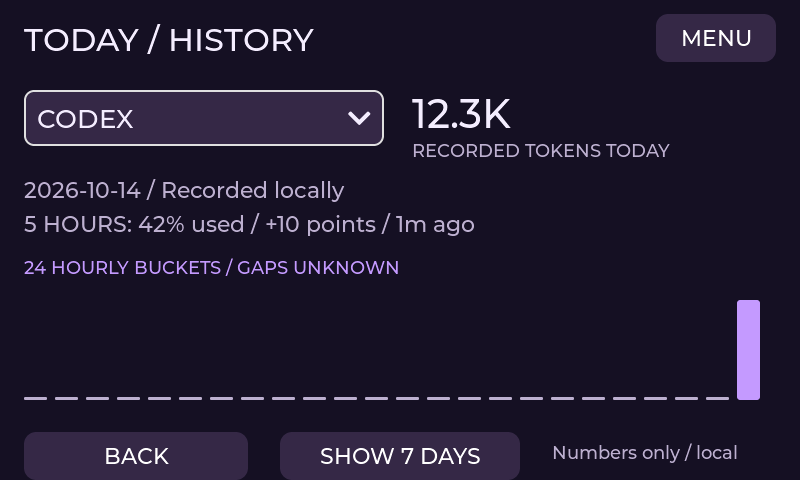
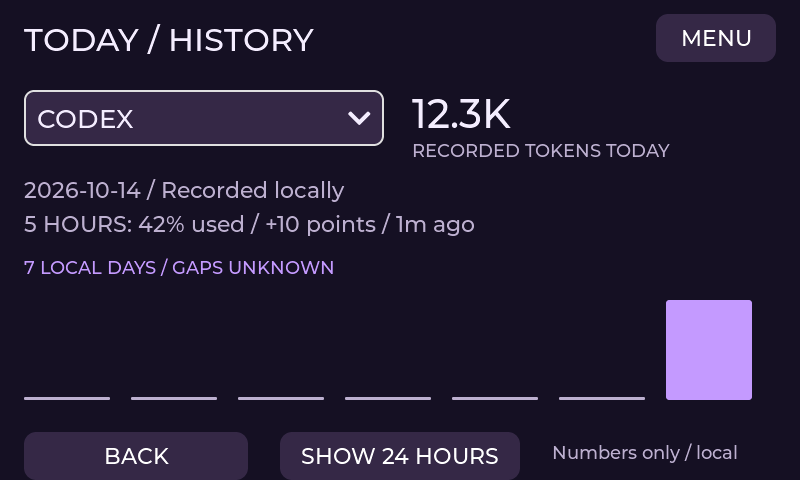

# Today and device history

Open MENU > HISTORY. Choose a provider to see recorded tokens today, its latest observed model
quota window and a graph of 24 hourly buckets or seven local days. BACK and the graph-period
button stay fixed. Provider option identities cannot change while the dropdown is open.

Enable **local usage history** in the PC app's Host settings to collect observations. History is
off by default. The existing PC SQLite database remains the only persistent history store;
the display receives bounded numeric summaries, never a database, prompt or transcript.

Grey gaps mean no observation. They are not fabricated zero activity. Today uses the PC's local
midnight; daylight-saving days may last 23 or 25 hours. Future buckets are excluded. Samples
older than two minutes are not sent, and sample age contributes to the display's stale marker.

The quota line identifies its exact model window. Percentage-point change is shown only across
observations of the same window, reset and recorder epoch. Tool/MCP quotas are not mixed with
model quotas. This is observation history, not billing, forecasting or task progress.

The opt-in event journal stores fixed Codex/Claude/ZCode lifecycle events and hashed session identities
in the same local SQLite backend. Schema-1 numeric databases migrate transactionally to schema 2
without changing token/quota records. Hooks retain no prompt, tool arguments, output or permission hint.
The journal is capped at 50,000 events and 30 days; hook writes use a 20 ms lock timeout.
Regular recorder housekeeping also removes old agent/task rows when hooks are idle.
Normal host stop and disabling history revoke write consent. The existing recorder
renews a 90-second lease every 30 seconds; after a crash, abandoned permission to
collect expires within 90 seconds. A source event cannot extend that lease.
Configuration saves, revocation and history transactions share a bounded process
lock. A persistent revocation floor prevents an older recorder from renewing a
revoked epoch, including rapid disable/enable changes. Workers check the current
saved policy before minting or committing. Same-epoch renewal does not drop events.
A turn can start before midnight and finish on the next day; its outcome belongs
to the day of its terminal event, independently of the 15-minute activity-gap limit.

Today also shows observed sessions, active time, completed turns and failed turns when their real
events are available. Session counts require SessionStart. Turn counts require a prompt-start event
and its matching Stop/StopFailure. Waiting is excluded; intervals longer than 15 minutes are unknown.
Concurrent agent activity is unioned, rather than counted twice. Time means observed intervals,
not guaranteed total work time. Missing events/unsupported providers stay `--`.
These are turns, not completed tasks. TaskCreated/TaskCompleted hooks can precede a veto and do not
prove task success. Claude Code task totals use a separate confirmed post-tool contract, described
below. Unsupported providers/metrics remain unavailable.
An interruption/session end closes activity without inventing completed/failed-turn
counts when no Stop/StopFailure was observed.
The live-agent screen's current session timers remain a separate source/domain.

The PC History tab also displays a daily agent summary for the selected provider over seven or
30 local calendar days: observed sessions, active seconds, completed turns and failed turns.
Unknown values stay `--`. Days use local midnights, including 23/25-hour daylight-saving days.
An event exactly at midnight belongs to the next day, while a known activity interval ending
there can close the preceding day's active time. Provider changes clear the previous summary
and disable export until the new selection has finished loading.

CSV export includes these observed metrics even when no token or quota sample exists. Local
lifecycle dates use the explicit `local_date` column; numeric quota timestamps retain UTC.
Unknown metrics are omitted rather than exported as zero. A zero failed-turn count means real
completed/failed turn evidence was observed without failures; it is not a count of task success.

History protocol 2 adds a strictly bounded `agents` summary to each provider packet. Schema 3 adds
nullable created/started/completed/failed task counters. Schemas 1 and 2 are still accepted and
the host sends only the fields supported by the connected device. No event log/database is
transferred to the display. Collection stops when local history is disabled or the recorder shuts down.

One coalesced background reader queries the existing database with its hard SQLite deadline.
The serial owner sends one begin packet and at most eight provider packets, each under AIM1's
4095-byte bound. The receiver publishes only the complete transaction, preserves previous data
on a failed/expired transfer and clears the view when history is disabled. History has its own
snapshot and cannot change quota, token activity, live agents or permission authority.

Synthetic tests cover local-day boundaries, gaps, overflow, invalid schema, future timestamps,
source selection changes, receipt correlation, atomic transfer/replay/expiry and actual LVGL layout.

## Client-reported task outcomes

Claude Code's successful `PostToolUse` result for TaskCreate confirms creation. TaskUpdate counts
a start/completion only when `success` is exactly true, input/response task IDs agree, and the
structured statusChange confirms a real transition. The contract was checked with the installed
Claude Code 2.1.296 client using an isolated own task and TaskGet readback. Other response shapes
fail closed. TaskGet alone does not establish when an old task completed; pre-veto hooks and
failed task-update calls never increase completion totals. Counts are distinct tasks per local day,
so duplicate delivery and repeated completion observations cannot inflate them.

Claude setup, link removal/status and local activity readers also honor
`CLAUDE_CONFIG_DIR`. An explicitly supplied test home remains isolated.
Task identities use the effective Claude configuration root and task-list ID
(`CLAUDE_CODE_TASK_LIST_ID`, otherwise the session ID). Shared lists deduplicate
across sessions while separate lists remain distinct. Rc8 uses versioned hashes.
Existing rows remain; mixed legacy/new identities in the same daily task metric
make that metric unknown because safe deduplication is impossible. Legacy-only
and new-only metrics still count normally. No raw task-list identities are stored.

The existing opt-in SQLite backend gets a bounded `task_events` table while retaining schema-2
numeric compatibility. Only hashed task/session/tool-call identities, generation, consent epoch,
fixed event and timestamp are retained. Task subjects, descriptions, arbitrary arguments and tool
output are not stored or sent to the display. The table has a 50,000-event/30-day cap and uses the
same short hook-write deadline and consent-revocation checks as lifecycle history.

The PC table/CSV and P4 history distinguish client-reported tasks from turns. A client marking
work complete is not proof that builds/tests passed. Failed-task counts stay unknown because
the verified Claude TaskUpdate contract does not report task failure. Codex/ZCode task outcomes
also stay unknown until a supported confirmed interface is available; their session/turn history
continues to work.

Custom model IDs such as GLM may need `CLAUDE_CODE_ENABLE_TODO_TOOLS=1` in the Claude client's
environment to expose its task tools. This does not grant file/shell permissions or enable physical
approvals. See the official [task tools reference](https://code.claude.com/docs/en/tools-reference#task-tool-availability)
and [hook decision contract](https://code.claude.com/docs/en/hooks#taskcompleted).
