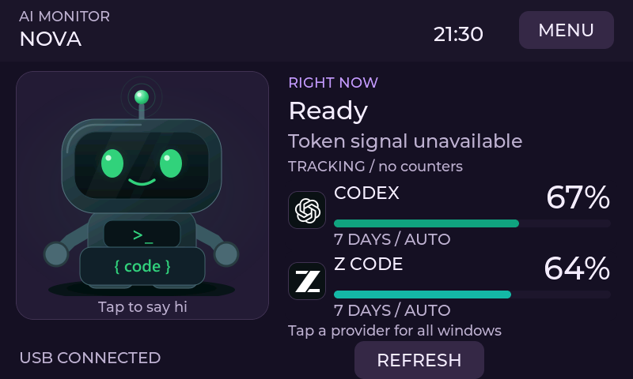
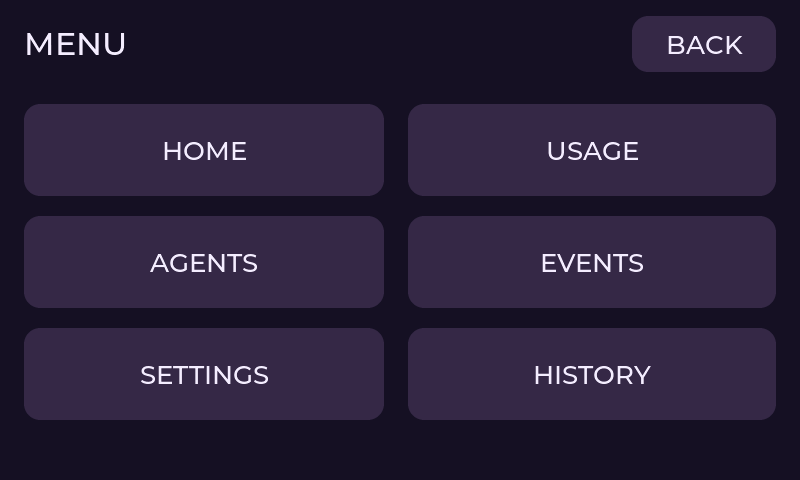
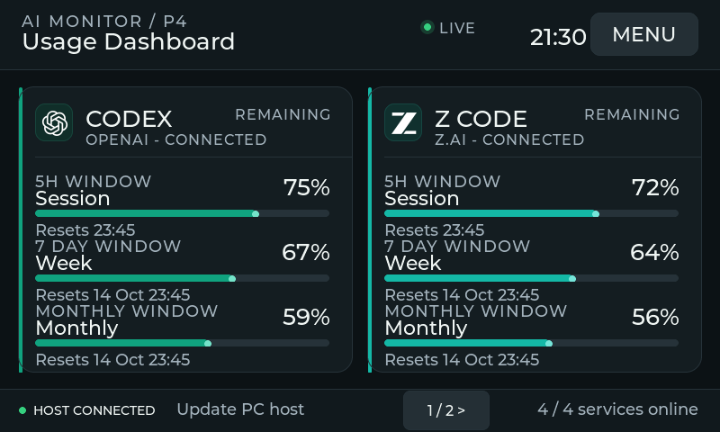
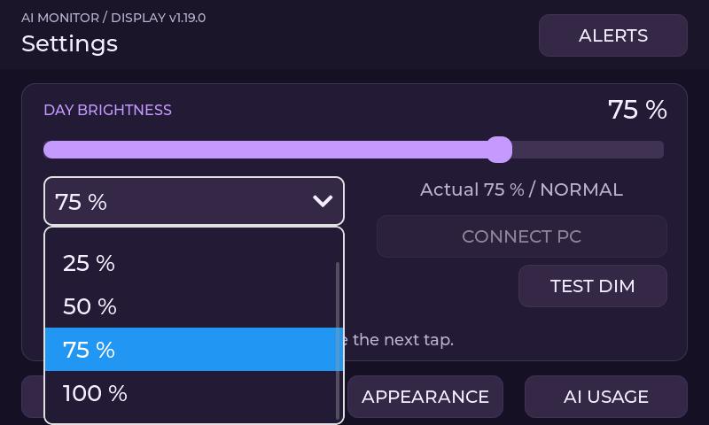

# Device navigation and readability

The 800 x 480 device UI uses a single MENU entry for navigation and secondary actions.
Normal NOVA/ORBIT home shows MENU and a large, fixed REFRESH button. Refresh is disabled
when the host is disconnected, does not support manual refresh, or is already updating.
NEXT appears only when more providers
exist; hiding it does not reposition other controls. Provider cards still open their details.

MENU contains HOME, USAGE, AGENTS, EVENTS, SETTINGS and HISTORY in large 92-pixel targets,
with a 56-pixel BACK target. BACK returns to the calling screen; Settings also returns to that
screen after closing. REFRESH stays directly on the home screen and checks host presence,
capability and busy state again on activation. HISTORY provides the compact Today/24h/7d view.
Quota popups are suppressed while navigating the menu, without dismissing the underlying alert.

Usage always shows two full-size provider cards per page, including with three to eight providers.
The former four-card compact grid and redundant home/update buttons are removed. The same
provider identity is retained until touch release, even when host data or provider ordering changes.

Important home status is 24-32 pixels, percentages 40 pixels, provider names 22 pixels and
provider status 20 pixels. Agent names use 26 pixels, states 24 pixels and timers 20 pixels.
Notification headings use 24 pixels and details 20 pixels. Detailed telemetry may retain smaller
secondary text; the main screens no longer depend on tiny compact cards.

Settings replaces eight individual brightness/dimming choices with two 56-pixel dropdowns
using 26-pixel text. The brightness slider and test-dimming action remain available. Choices are
unchanged and persisted through the existing settings code.

The new menu participates in all four saved palettes. Native LVGL tests cover fixed control
geometry, navigation/return paths, page changes, refresh gating, settings persistence, large
dropdown layout, provider rebinding and the existing touch/dimming/permission regressions on
both P4 and S3 build profiles. These images are synthetic native previews, not hardware photographs.
