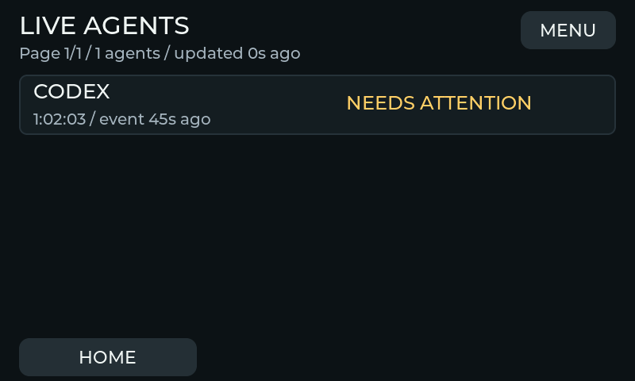
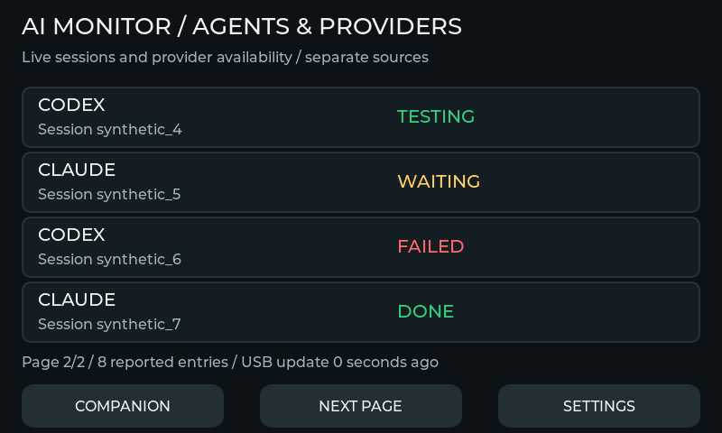
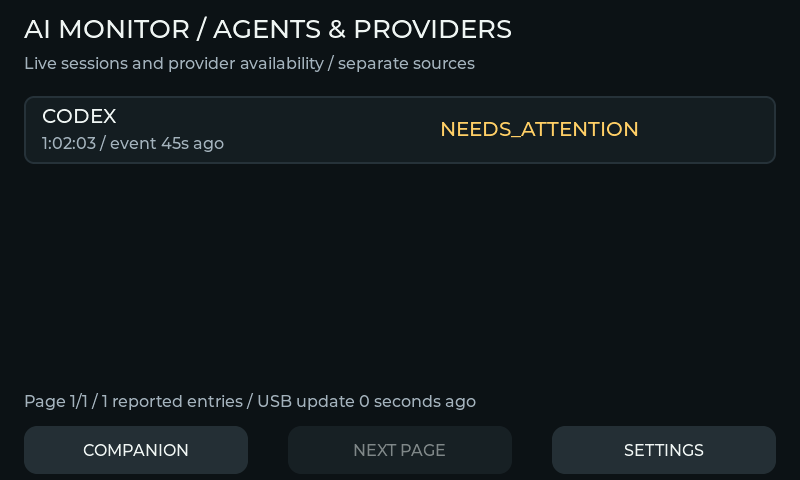

# Live agent view

Open **MENU > AGENTS**. This read-only view consumes the separate USB live
snapshot; it does not change quotas, issue provider commands or approve tools. Four fixed rows per
page show the provider, shortened opaque session ID and last reported state. At most eight entries
are published; this is not the provider's total agent count. WAITING and FAILED use text and color.

Selected providers without recent live sessions now have separately labelled provider-status rows,
so Codex/ZCode do not disappear just because hooks are absent. These rows come from quota/token
source availability and never create live agents. Codex/Claude show NO RECENT EVENTS; other providers
show ACTIVITY ONLY. A readable token counter does not establish a working phase. Live sessions and
provider statuses are counted separately; pagination can cover up to eight of each.

MENU, HOME and NEXT PAGE stay in fixed positions. NEXT PAGE is hidden when there is
only one page; other targets do not move. A new transport epoch or a reduced entry count returns safely to page one. Hidden rows
have their text cleared. After thirty seconds without a valid USB update, entries disappear and
setup/reconnect guidance is shown. UNKNOWN preserves missing phase information. DONE means a turn
stopped; it does not prove that a task or its tests succeeded.

Provider sources and setup limits are described in [local lifecycle events](LIVE_PROVIDER_EVENTS.md).
The observer's thirty-second source freshness is separate from the device's transport lease.
Only reported data is displayed; shell commands are not inspected to guess testing/building.

This preview is generated by the actual native LVGL implementation with synthetic events. It is
not a photograph or proof of physical touch/USB performance. Native tests for both board identities
cover opening from NOVA, pointer page navigation, drag-out cancellation, fixed button coordinates,
shrinking pages while pressed, clock rollover,
epoch changes, theme updates, expiry/disconnect clearing and returning to the companion screen.
Physical USB/client exchange, installation of current executables and P4 touch validation remain
required before release. Physical S3 validation remains unavailable.

## Observed timers and generic phases

Metadata capability 2 adds WORKING, READING, WRITING, RUNNING, NEEDS_ATTENTION, ERROR and
COMPLETED to the generic agent state model. Each row shows an observed turn/subagent duration
when a start exists, plus explicit last-event age. Unknown starts are labelled; navigation is fixed.
Older firmware receives downgraded three-field metadata. NOVA reacts only to recent explicit
client events, and provider session counts are not counted twice.

This is a synthetic native preview, not a physical screenshot or proof of real Codex delivery.
