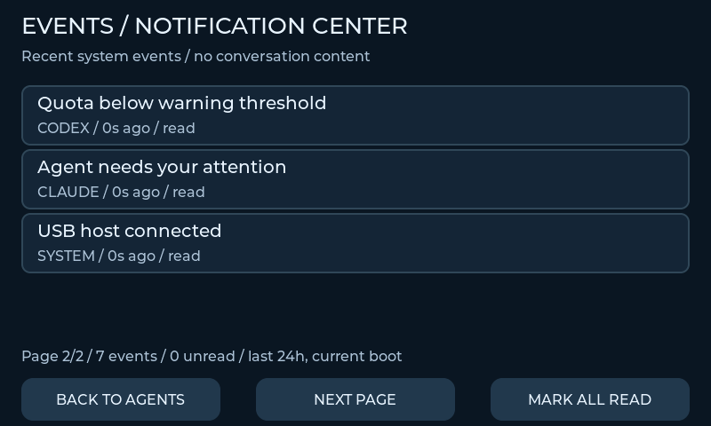

# Device notification center

Open **MENU > EVENTS**. The summary shows the unread count; the center provides
four fixed rows per page, NEXT PAGE when needed, BACK and READ ALL. Reading notifications
never approves a tool, dismisses a provider permission or executes a command.

The bounded in-memory center holds at most 32 events for 24 hours within the current device boot:

- observed agent activity start, response completion, attention and error transitions;
- USB host connection/disconnection;
- current quota warning/critical transitions from the existing quota policy.

Entries store a fixed event type, provider/source, rollover-safe local time and read flag. Text comes
from fixed English strings. There are no prompts, hints, tool arguments, paths, credentials or
transcripts, and nothing is persisted. Entries use relative age and are ordered by event time.
Missing actors are never turned into completion events. Repeated unchanged states are deduplicated.
Only source observations no older than 30 seconds create agent events.

This first device center observes normalized snapshot transitions, rather than an exhaustive
PC event journal: very short transitions between host samples can be absent. COMPLETED means a
reported response/agent ended, not a confirmed task/build/test success. Structured task requests are
stored separately on the PC and do not create success notifications here. Permission decisions,
companion-pack failures and storage/build integrations remain separate future event sources.

Quota popup behavior remains independent. The center hides the popup while visible, and marking
an entry read does not acknowledge or suppress future quota warnings. The center participates in
all four palettes without moving controls.

Native tests cover bounded storage, repeated snapshots, disconnect, terminal/attention events,
expiry/rollover, paging, empty data, read marking, stable controls and theme application. Physical
USB/boot/memory checks are recorded in V2_VALIDATION.md after flashing.

This preview uses synthetic events; it is not a photograph or real account activity.
