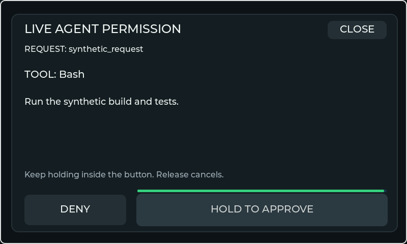

# Live permission UI prototype

The v2 permission dialog is implemented and tested with actual native LVGL pointer input.
It is **not initialized in production** and has no BLE adapter or real permission sender.
USB/AIM1 quota monitoring, provider setup and companion rendering remain separate.

This preview uses a synthetic request. It is not evidence of a paired device or a real tool approval.

## Interaction contract

`PermissionView` has fixed DENY and HOLD TO APPROVE targets, request identity, tool, full bounded
hint and hold progress. Approval requires a continuous 1,800 ms hold with fresh successful pointer
samples inside the same target. CLICKED, keyboard activation, short taps and long-press notifications
never approve. Drag-out, release, failed touch reads, navigation, stale data, changed ID or complete
details, disconnect, opt-out, sleeping or demo mode cancel the action.
The fixed CLOSE button also cancels outstanding queue/commit authority, including for a request
that cannot be reviewed or approved locally. It never sends a permission decision.

Every detail must fit and remain visible. Unsupported glyphs or overflowing details are nonapprovable;
the user reviews those requests on Desktop. A popup above the dialog, system overlay, hidden field,
opacity change or clipped/moved dialog also blocks its final send gate. Label content is compared
with the full canonical request, not a displayed prefix. Buttons remain in the same coordinates
through state and text changes, including while pressed.

## Authority, queue and final send

The interaction authority is `PermissionController`, independent of LVGL, parser and transport.
It must outlive its view; closing/recreating widgets must not reset the consumed-request ledger.
Only trusted local connection/security/settings/display state can create `PermissionContext`.
All flags default closed. JSON cannot assert host trust, opt-in or an authenticated connection.

The future adapter must follow this sequence:

1. Feed validated, bounded snapshots through synchronized copies. Never share a mutable parser
   snapshot with the UI thread, and never retain/log transcript or request hints in history/export.
2. Update/show the view on the UI task using the same monotonic millisecond clock as the parser.
   Full visibility is verified before the request enters DISPLAYED and before accepting pointer input.
3. After an earned hold or denial, `take` prepares exactly one bounded envelope for the queue.
   An envelope alone is **not** authorization to send.
4. Immediately before TX, the UI owner calls `commit` with a fresh snapshot and trusted context.
   The view rechecks actual visibility/text; the controller rechecks issued identity, lease, security
   and state, then consumes that issued envelope even on failure.
5. The transport rechecks its current authenticated link/epoch at submission and sends once.
   Serialize only the exact request ID and allowlisted decision, not the tool/hint. Failed or
   ambiguous delivery enters ERROR and is never retried as an approval. No delayed queue may bypass
   this final gate or use stale visibility/security values.

An omitted prompt or successful transport write is not an acknowledgement. The archived
[Hardware Buddy reference](https://github.com/anthropics/claude-desktop-buddy/blob/main/REFERENCE.md)
does not define a correlated permission ACK. ACKNOWLEDGED remains reserved for a documented trusted
acknowledgement source; the current prototype never invents one.

## Validation and remaining gates

The pure controller tests cover incomplete display, interrupted holds, final prompt/epoch/security
checks, expiry, one-time queue/commit consumption and cancellation after queue handoff.
Native P4/S3 identity tests cover 22 pointer/visibility scenarios: valid hold, denial, short tap,
touch failure, drag-out, changed IDs/details, disconnect, expiry, unsupported/long text, demo,
sleep/opt-out, popup/system overlays, navigation, hidden/faded/clipped details and altered visible
text and closing after queue handoff. They also verify fixed controls and that view recreation
cannot repeat a consumed approval.

These tests do not establish physical touch reliability or real provider permission behavior.
Bluetooth is permanently excluded; future integration uses USB through the existing PC host.
A production adapter requires independently verified host trust, a documented provider decision
interface, explicit local opt-in, synchronized publication, bounded TX/RX and physical disconnect
tests. USB attachment alone cannot assert security. See [USB-only integration](USB_LIVE_TRANSPORT.md).
The default remains no live permission transmission.

The updated production plan uses a separate AI-Monitor-Permission helper for Claude Code's
PermissionRequest hook, same-user local IPC and the existing USB host. AI-Monitor-Events must never
gain permission authority. Generic interaction/request/decision types and trustedChannel context
now replace the prototype's ClaudeLiveSnapshot/security dependency in the permission UI.
Keep every tested physical hold, cancellation, visibility and single-use final commit check.
The separate helper, same-user IPC and host broker/service have synthetic tests, including actual
local Windows pipe roundtrips. Authenticated USB integration and explicit opt-in setup remain
pending; the host does not start the service. See [implementation status](USB_PERMISSION_HELPER.md)
and [phase 7](../plans/COMPANION_V2.md).
