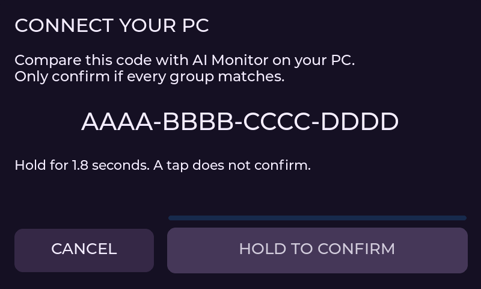

# Authenticated USB interaction foundation

Enrollment is connected to explicit PC/device setup; **production permission control is disabled**.
The generic permission dialog remains dormant. No enrolled key, interactive Claude hook or real
tool approval was created by these tests. Normal USB/AIM1 quota monitoring remains independent.

## Enrollment and stored authority

`tools/interaction_auth.py` implements the PC side of ephemeral P-256 ECDH enrollment. HKDF-SHA256
binds both public keys, nonces, device identity and boot identity into the new key. A 64-bit code,
shown as four groups of four hexadecimal characters, must match on the physical device and PC.
The PC must explicitly confirm that comparison; it cannot create a TrustRecord until the device
returns the matching enrollment proof. The device gates that proof on a physical continuous hold
and successful device-side persistence. Physical end-to-end validation remains pending.

`tools/interaction_trust.py` stores only an encrypted record with Windows current-user DPAPI and
installation-specific entropy. There is no plaintext key in the file. Wrong-user/installation,
invalid records, symlinks and default all-zero keys fail closed. Writes are atomic. These files
are excluded from Git and rejected by release export. There is no network listener or cloud account.

The DPAPI tests use temporary synthetic keys, not existing provider credentials. Same-user
trust does not protect an already compromised user account; no claim of universal PC security
is made. Device-side trust storage is integrated, with physical enrollment validation still pending.

## Normal authenticated sessions

`src/interaction/auth_session.h` and the PC SessionHost mutually prove an already enrolled key.
The transcript binds the device, host instance, both nonces, boot identity and device epoch.
Separate labeled proofs and a derived session key prevent reflection between handshake stages.
Authentication has a three-second deadline; established sessions expire after five seconds without
valid authenticated traffic. No JSON boolean or board-model match establishes authority.

Every subsequent packet authenticates its direction, session, strictly increasing sequence,
exact body bytes and body length with HMAC-SHA256. Bodies are bounded to 1,024 printable ASCII
bytes. Duplicate/noncanonical JSON, booleans masquerading as integers, stale packets, overflow,
wrong proofs and crypto failures close the interaction channel. Quota/live-agent state is separate.

`src/interaction/usb_interaction.h` accepts only heartbeat, request, cancel and close bodies.
Requests have exact ID/nonce/revision/tool/full-hint/expiry fields, a maximum 25-second lifetime,
one pending request and a bounded 32-entry replay ledger per authenticated session. Heartbeats
renew the channel lease but never the permission deadline. An undecided request cannot be replaced.
The final transport decision gate consumes an earned envelope once and rechecks the current
authenticated request. It cannot earn the physical UI hold itself.

`tools/usb_interaction.py` uses the existing Panel serial owner, never a second port. It connects
the authenticated request/decision path to the dedicated same-user IPC service. Correlation and
expiry are rechecked before resolving the helper. An unavailable/corrupt/expired channel cancels
the request and retains the normal Claude permission fallback. No ambiguous decision is retried.

ProtoCore has optional command/tick extension points. No interaction state is added to aim::Snapshot.
Without the production adapter, get_info reports interactionProtocol 0 and interaction commands
fail closed. Registering an adapter is a capability declaration, not a trust assertion.

## Validation

- Real Python/OpenSSL P-256 ECDH/HKDF enrollment and current-user Windows DPAPI tests.
- Python/native C++ bidirectional HMAC interoperability, using Windows CNG or OpenSSL for native
  cryptography; strict compiler warnings are errors. There is no fake hash callback in these tests.
- Synthetic request/receipt/denial/cancellation through native transport, host broker, serial-owner
  adapter and the documented helper output contract. No real Claude tool is involved.
- Replay, reflection, corrupted signature, type confusion, unsupported fields/point, opt-out,
  deadlines/clock rollover, empty keys, request replacement, nonce mismatch and one-time decisions.
- Existing native LVGL pointer/hold/visibility/touch failure tests continue to pass.
- ESP Mbed TLS primitives compile for both production targets. A private P4 benchmark physically
  verified the known-answer HMAC test, hardware-seeded CTR-DRBG, P-256 agreement and HKDF derivation.
  Two key generations: 11,114 us; two agreements: 10,080 us; one HMAC: 81 us. These are isolated
  primitive timings, not end-to-end permission latency. The ordinary UI image was restored afterward.

The developer benchmark runs once per boot, uses only ephemeral keys, never writes NVS and has
no permission sender. It is excluded from normal builds/release collection. Its numeric evidence is
in `.ecc/benchmarks/p4-usb-auth-crypto-2026-10-14.json`.

## Remaining activation gates

The device enrollment core (`src/interaction/enrollment.h`) now implements local-only arming,
one offer, a matching 64-bit comparison code, revision-bound physical confirmation, PC proof and
successful storage before acknowledgment. Its 60-second deadline starts at local arming; repeated
offers, stale UI confirmations, hidden/asleep UI, cancellation, malformed inputs and crypto/storage
failures clear the ephemeral key and code. Enrollment does not enable permission opt-in.
The ESP adapter is now connected to a dedicated enrollment-only USB capability. This does not
enable authenticated permission commands: enrollmentProtocol is 1 while interactionProtocol stays 0.
The serial task owns crypto/NVS, the UI owns all LVGL, and bounded local queues carry only revisions
and physical actions. Visibility/awake freshness is rechecked before and after storing a record.
Comparison/confirmation also requires a three-second enrollment-specific channel lease. Only
valid enrollment status polls renew it; quota heartbeats cannot revive an expired exchange.
P4 additionally checks the current hardware CDC connection at the final storage gate. Local
arming survives the initial host-to-setup port handoff, before any comparison key is accepted.

Device storage uses one fixed 104-byte versioned blob in the separate `aimtrust` NVS namespace,
with SHA-256 corruption detection and mandatory readback. The checksum is not an authenticity
claim and does not substitute for physical flash protection. Permission opt-in is never restored
from the record. Forgetting targets only this key; it never erases a partition or unrelated settings.

Open MENU > SETTINGS > CONNECT PC on the awake display, then choose **Connect this PC to the
display** in the PC app's display setup. Both screens show a four-group comparison code. Hold
HOLD TO CONFIRM on the display for 1.8 seconds and explicitly confirm matching codes on the PC.
The PC action pauses/restores only this installation's host and owns the port while connecting.
Only a valid device proof is stored under current-user DPAPI. Decline, reboot, timeout, storage
failure or ambiguous commit never retries an approval or enables permissions.

Native interoperability tests use actual Windows CNG P-256/SHA-256/HMAC (OpenSSL on Linux),
confirm that PC/device comparison codes match, and authenticate a subsequent session with the
stored key without exporting it. Windows RAW_SECRET is converted from its documented little-endian
representation before HKDF; see [Microsoft's contract](https://learn.microsoft.com/en-us/windows/win32/api/bcrypt/nf-bcrypt-bcryptderivekey).
These are synthetic fixtures, not physical enrollment or a real Claude permission.

Physically validate the connected enrollment/setup/storage path. Then implement separate Claude
permission opt-in, synchronized permission UI publication/TX final gates and host startup integration.
Validate the exact packaged programs and real hold/deny/unplug behavior.
Until these gates pass, no service/hook is started automatically and no production approval is sent.

References: [Mbed TLS HMAC](https://mbed-tls.readthedocs.io/projects/api/en/v3.6.3/api/file/md_8h/),
[ESP entropy requirements](https://docs.espressif.com/projects/esp-idf/en/latest/esp32p4/api-reference/system/random.html),
[P-256 ECDH](https://cryptography.io/en/latest/hazmat/primitives/asymmetric/ec/),
[Windows current-user DPAPI](https://learn.microsoft.com/en-us/windows/win32/api/dpapi/nf-dpapi-cryptprotectdata).
